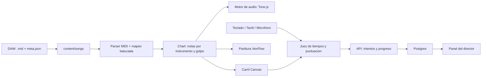

# Plan de desarrollo (origen)

Decisiones de producto con las que se construyó la primera versión. **No actualiza el estado:** para eso usa [`estado.md`](estado.md) (hecho) y [`roadmap.md`](roadmap.md) (pendiente).

## Decisiones

- Tipo de grupo: batucada/samba (surdo 1/2/3, caixa, repinique, tamborim, agogô, chocalho).
- Entrada: teclado, pantalla táctil y micrófono.
- Plataforma: aplicación web responsive (PC y móvil), instalable como PWA.
- Canciones: vienen en la app; las añade el director (carpeta de contenido + script de validación).
- MIDI: se crean en un DAW, una pista por instrumento y una nota distinta por tipo de golpe.
- Progreso: cuentas de usuario y progreso en la nube, con un panel para el director.

## Stack elegido

Next.js (App Router) + TypeScript + Tailwind + shadcn/ui. Lectura MIDI con `@tonejs/midi`. Audio con Tone.js. Carril en Canvas 2D. Partitura con VexFlow. Micrófono con AudioWorklet propio. Backend: Route Handlers + Postgres + Drizzle + Better Auth (`director` / `miembro`). Tests: Vitest y Playwright.

## Alcance por bloques

Todos estos bloques **están implementados** en `main` (con matices en el roadmap: despliegue permanente, samples reales, micrófono en hardware).

1. **Convención MIDI y formato de canción** — nombres de pista, tabla de notas, `meta.json`, parser, `songs:check`.
2. **Motor de audio y práctica** — samples o sintetizador, mute/solo, velocidad, metrónomo, bucle A-B.
3. **Jugabilidad** — carril, teclado y táctil, juez, combo, calibración de latencia.
4. **Micrófono** — detección de ataques; fase A (tiempo); fase B opcional (tipo de golpe).
5. **Partitura** — cuantización, VexFlow, vistas y bucle desde los compases.
6. **Cuentas y progreso** — auth, grupos, API de intentos con cola, paneles de miembro y director.
7. **Entrega** — PWA, tests, guía Vercel + Neon (falta el proyecto de producción).

## Riesgos que siguen vigentes

- Latencia de audio en móviles (sobre todo iOS): calibración por dispositivo y auriculares con cable.
- Micrófono con surdo fuerte o salas con eco: por eso la fase A juzga solo el tiempo.
- Samples con licencia: lo correcto es grabar los del propio grupo.
